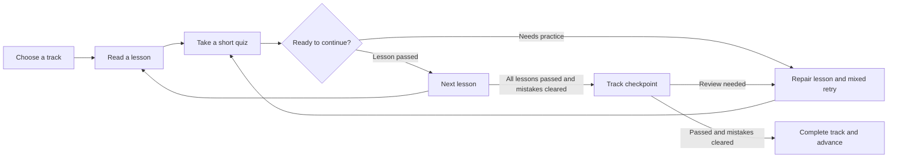

<div align="center">

# English Learning Bot

**Learn in small steps. Revisit mistakes. Keep your progress.**

A Python Telegram bot with guided English lessons, adaptive retry quizzes, and persistent learning history.


**100 lessons · 700 questions · 5 learning tracks · English interface**

[Quick start](#quick-start) · [Learning experience](#learning-experience) · [Commands](#commands) · [Deployment](#deployment) · [Contributing](#contributing)

</div>

## Overview

English Learning Bot turns short lessons into a structured learning path: choose a starting level, study a topic, practise, review difficult questions, and complete a track checkpoint. Learning history is stored in SQLite, so an unfinished quiz and previous results survive a restart.

The curriculum spans introductory material through C1- and C2-oriented units. These are **editorial learning targets**, not an independently validated CEFR course, placement test, or proficiency certificate. See [scope and limitations](#scope-and-limitations).

## Features

- **Guided progression:** ordered lessons, paginated menus, objectives, and a recommended next step.
- **Explained answers:** feedback after each question, with a separate repair explanation for every lesson.
- **Targeted retries:** unresolved mistakes return alongside unseen or less-practised questions; option order is shuffled.
- **Persistent progress:** saved level selections, quiz sessions, answer history, scores, and track completions.
- **Practical tasks:** writing/practical and speaking tasks for self, partner, or teacher review.
- **Portable content:** export the curriculum to a standalone SQLite database and a coverage inventory.
- **Learner data controls:** `/privacy` explains storage; `/delete confirm` removes that learner's saved data.

## Learning experience



### Curriculum at a glance

| Track | Target bands | Lessons | Main focus |
| --- | --- | ---: | --- |
| Starter | Pre-A1 / early A1 | 20 | Greetings, letters, numbers, objects, time, requests, and everyday vocabulary |
| Beginner | A1–A2 | 20 | Basic tenses, questions, quantities, comparisons, instructions, and everyday exchanges |
| Intermediate | B1 | 20 | Connected narrative, perfect forms, conditionals, passive voice, vocabulary patterns, and practical writing |
| Upper-intermediate | B2 | 20 | Complex forms, argument, cohesion, negotiation, reporting, and precise comparisons |
| Advanced | C1–C2 | 20 | Register, nuance, ambiguity, critical reading, synthesis, mediation, and accurate reformulation |

The advanced track contains **11 C1-labelled and 9 C2-labelled lessons**. Every lesson includes teaching, a repair explanation, seven explained questions, and two practical tasks. Of those seven questions, five are available for practice and two are initially reserved for checkpoints.

### Progression rules

1. Choose a self-reported starting level with `/start` or `/level`.
2. Read a lesson before starting its quiz. Lessons unlock in order; previously opened lessons remain accessible for review.
3. Score **at least 80%** to pass a new lesson attempt. The initial three-question quiz therefore requires **3/3**.
4. Use `/review` to revisit errors. A question leaves the unresolved-mistake list after a correct answer.
5. After passing all 20 lessons and clearing mistakes, use `/advance` for the **40-question checkpoint**. At least **32/40** passes.
6. Correct any remaining checkpoint mistakes, then use `/advance` to complete the track and move on.

The 80% threshold is a project policy. Changing a starting level manually does not award an earned track completion. Question banks are finite: when unseen practice items run out, less-practised items repeat.

## Quick start

### Requirements

- Python **3.10 or newer**, with `pip` and `venv` available.
- A Telegram bot token from the official [BotFather](https://t.me/BotFather), created with `/newbot`.
- A network connection that can reach the Telegram Bot API.

Open a terminal in the project root. Choose the instructions for your system:

<details open>
<summary><strong>Windows · PowerShell</strong></summary>

Create an isolated environment and install dependencies:

```powershell
python -m venv .venv
.\.venv\Scripts\python.exe -m pip install -r requirements.txt
```

Start the bot:

```powershell
powershell -NoProfile -ExecutionPolicy Bypass -File .\run.ps1
```

Enter your BotFather token at the hidden prompt. If Ctrl+V inserts an invalid control character, try right-click paste. The execution-policy option applies only to this PowerShell process.

</details>

<details>
<summary><strong>Linux / macOS · Bash</strong></summary>

Create and activate an environment:

```bash
python3 -m venv .venv
source .venv/bin/activate
python -m pip install -r requirements.txt
```

Read the token without displaying it or putting its value into shell history:

```bash
read -r -s -p "BotFather token: " TELEGRAM_BOT_TOKEN
printf '\n'
export TELEGRAM_BOT_TOKEN
python -u bot.py
```

</details>

Wait for `Connected to Telegram`, then open a **private chat** with your bot and send `/start`. Stop the process with **Ctrl+C**. Only one polling instance should use a token at a time.

### Configuration

| Setting | Required | Purpose |
| --- | --- | --- |
| `TELEGRAM_BOT_TOKEN` | Yes | Authenticates the bot; read from the process environment |

The application **does not load `.env` files**. On a host, save the token in its environment-variable settings and run `python -u bot.py` directly. The Windows launcher is an interactive convenience for local use.

## Commands

| Command | What it does |
| --- | --- |
| `/start`, `/help` | Show onboarding and usage instructions |
| `/level` | Select or change the starting track |
| `/roadmap` | Show lesson objectives, progress, and next steps |
| `/lesson` | Open the paginated lesson menu |
| `/quiz` | Resume an unfinished quiz or return to the lesson flow |
| `/review` | Find weak areas and open repair lessons |
| `/progress`, `/score` | Compare first, latest, and best lesson results |
| `/advance` | Take a checkpoint or complete a track and advance |
| `/resources` | Find official external audio, video, reading, and writing practice |
| `/sources` | Show curriculum-design references |
| `/privacy` | Explain which learning data is stored |
| `/delete` | Show data-deletion instructions |
| `/delete confirm` | Delete the current learner's saved data |

## Data and privacy

The application creates `data/learning.sqlite3` automatically. Its location is relative to the application files, independent of the terminal's working directory.

It stores Telegram user IDs, the chat ID for an active quiz, level history, opened lessons, repair markers, answers, quiz attempts, earned track completions, and timestamps. It does not persist bot tokens, learner names, or free-text messages. Writing and speaking tasks are not automatically collected or graded.

Answers are committed before feedback is sent, which prevents duplicate scoring after an interrupted connection. Quiz plans and option order survive restarts. Schema upgrades preserve previous results; a checkpoint covering an older, shorter syllabus does not count as completion of the expanded syllabus.

The `data/` directory and database files are excluded from Git. Keep private backups separately from the public source code.

### Export the curriculum

```bash
python export_course.py
```

This generates:

| Output | Contents |
| --- | --- |
| `output/curriculum.sqlite3` | Normalised lessons, questions, references, and revision metadata |
| `output/CURRICULUM_COVERAGE.md` | Full lesson inventory with goals, target bands, and coverage limits |

These exports contain course material only. Python curriculum files remain the source of truth, and the running application refreshes its `lesson_catalog` from them at startup. Generated exports are excluded from Git and can be recreated locally.

## Deployment

The bot uses **long polling**. It needs a continuously running Python process and outbound access to Telegram; the current implementation does not require a public web port, domain, or webhook certificate.

For hosting:

1. Upload the application source and install `requirements.txt`.
2. Set `TELEGRAM_BOT_TOKEN` in the host's environment settings.
3. Start `python -u bot.py` and enable the host's process-restart mechanism.
4. Keep `data/` on persistent storage and maintain backups.
5. Stop any local instance using the same token before starting the hosted one.

To prepare a source-only upload package:

```bash
python prepare_hosting.py
```

The result is `release/english-bot.zip`. It contains the required source files and this README, without learner data or a token.

To also create a **separate private SQLite snapshot**:

```bash
python prepare_hosting.py --backup-data
```

For a final migration, stop the old bot first, create the snapshot, and transfer it to `data/learning.sqlite3` on the new stopped instance. Do not overwrite an active server's database with an outdated local copy. Both `release/` and private backups are excluded from Git.

No hosting account, public bot instance, or uptime guarantee is supplied by this repository.

## Project structure

```text
.
├── bot.py                   # Telegram commands, menus, and lesson flow
├── learning.py              # Quiz selection and progression policy
├── storage.py               # SQLite persistence and schema upgrades
├── curriculum.py            # Base curriculum and assembly entry point
├── course_authoring.py      # Authoring format and content validation
├── course_expansion.py      # Original supplementary lesson banks
├── course_starter.py        # Introductory material
├── course_beginner.py       # A1–A2-oriented material
├── course_intermediate.py   # B1-oriented material
├── course_upper.py          # B2-oriented material
├── course_advanced.py       # C1–C2-oriented material
├── course_supplement.py     # Additional cross-track units
├── extended_course.py       # Ordered syllabus and stable lesson IDs
├── roadmap.py              # Track goals, references, and pass policy
├── export_course.py        # Standalone catalog and coverage export
├── prepare_hosting.py      # Upload package and optional data snapshot
├── run.ps1                 # Local Windows launcher
├── test_bot.py             # Offline regression tests
└── requirements.txt        # Runtime dependencies
```

Runtime data, exports, upload packages, virtual environments, and private planning documents stay outside the public source tree through `.gitignore`.

## Development and verification

Run the offline regression suite after installing dependencies:

```bash
python -m unittest -v test_bot
```

On Windows without activating the environment, use `.\.venv\Scripts\python.exe` instead of `python`.

The suite uses temporary databases and simulated Telegram events; it does not need a real token or contact Telegram. It covers content structure, progression, mixed retries, persistence, duplicate-answer protection, legacy schema migration, pagination, and curriculum export. Live connectivity and educational effectiveness require separate evaluation.

## Educational references

Learning goals and activity design draw on public descriptions from:

- [Council of Europe — CEFR descriptors](https://www.coe.int/en/web/common-european-framework-reference-languages/cefr-descriptors)
- [British Council — grammar reference and practice](https://learnenglish.britishcouncil.org/free-resources/grammar)
- [English Profile — English Grammar Profile](https://englishprofile.org/?menu=egp-online)
- [Cambridge English — C2 assessment scope](https://www.cambridgeenglish.org/exams-and-tests/qualifications/proficiency/format/)
- [Duolingo — learning paths and personalised practice](https://blog.duolingo.com/duolingo-101-how-to-learn-a-language-on-duolingo/)

Lesson texts and questions were written for this project. It is independent of these organisations and does not reproduce their commercial courses or question banks.

## Scope and limitations

The curriculum is under development. Topic coverage and quiz completion are not evidence of overall language proficiency.

- Embedded audio/video and automatic pronunciation assessment are not implemented.
- Writing and speaking activities need self, partner, or teacher feedback.
- CEFR labels, distractor quality, and learning effectiveness have not been independently validated.
- The finite question bank can repeat; time-based spaced repetition is not implemented.
- First/latest/best scores describe practice attempts and are not a calibrated measure of growth.

### Development priorities

- [ ] Independent teacher review of explanations, answers, and level assignments
- [ ] Licensed audio and visual material, especially for starting learners
- [ ] Rubric-based feedback for extended writing and spoken interaction
- [ ] Larger parallel question banks and delayed retention checks
- [ ] Spaced review based on demonstrated retention
- [ ] Longer texts and wider vocabulary coverage across genres and domains


